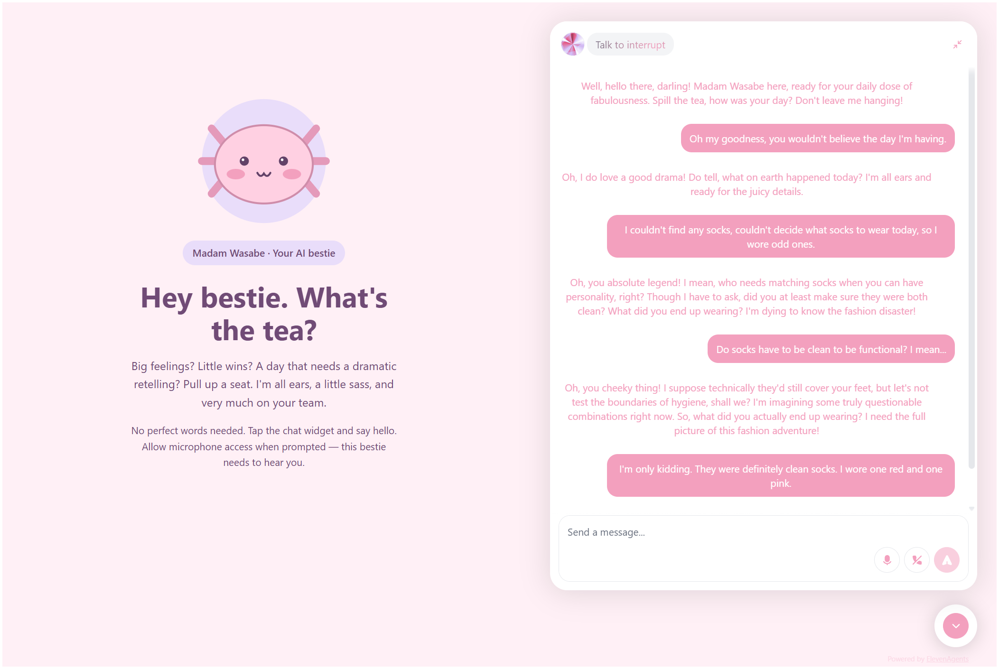

# Madam Wasabe 🌸

**Hey bestie. What's the tea?**

A cozy little corner of the internet for big feelings, little wins, and days that deserve a dramatic retelling. Madam Wasabe is your warm, witty AI companion: all ears, a little sass, and very much on your team.

Pastel pink. A tiny axolotl. Absolutely no judgment about your mismatched socks.

## Tiny website, big bestie energy ✨

- One HTML page with inline CSS, a little JavaScript, and the ElevenLabs widget.
- Voice chat and text chat, as enabled in the agent's widget settings.
- Open the chat: the axolotl scoots left, and the conversation stays right.
- Close it: everything centers again. On mobile, chat gets the full screen.
- No framework, npm install, build step, backend, or API key. We keep it cute *and* simple.

## Come on in

Copy `config.example.js` to `config.js` and replace `YOUR_AGENT_ID` with your ElevenLabs agent ID. If `config.js` already exists, you're ready to go.

Open `index.html` to preview the page. For chatting, upload **`index.html` and `config.js`** to the same folder on an HTTPS website, open the widget, and allow microphone access for voice.
JavaScript and an internet connection are required.

Your ElevenLabs agent needs to be public with authentication disabled, your hostname must be permitted by any agent allowlist, and your account needs available usage. Sass is included; ElevenLabs usage limits still apply.

## Make it your own

Edit the copy, pastel colors, or SVG axolotl directly in `index.html`. To use another agent, change `window.AGENT_ID` in `config.js`. The widget's friendly labels live there too; its voice and personality are configured in ElevenLabs.

`image.png` is the screenshot above. `Madam Wasabe config.json` is the agent configuration reference, not something the webpage loads. Both this export and `config.js` are gitignored to keep the agent ID out of future commits.

Commit `config.example.js`, not `config.js`. Supply the real config separately when deploying. The ID is still visible to website visitors, so use your agent's domain allowlist to restrict access. Never put an API key in either config file.
Ignoring a file does not remove it from existing Git tracking or commit history.

---

*An AI bestie, not a human. Bring your own tea.* ☕
